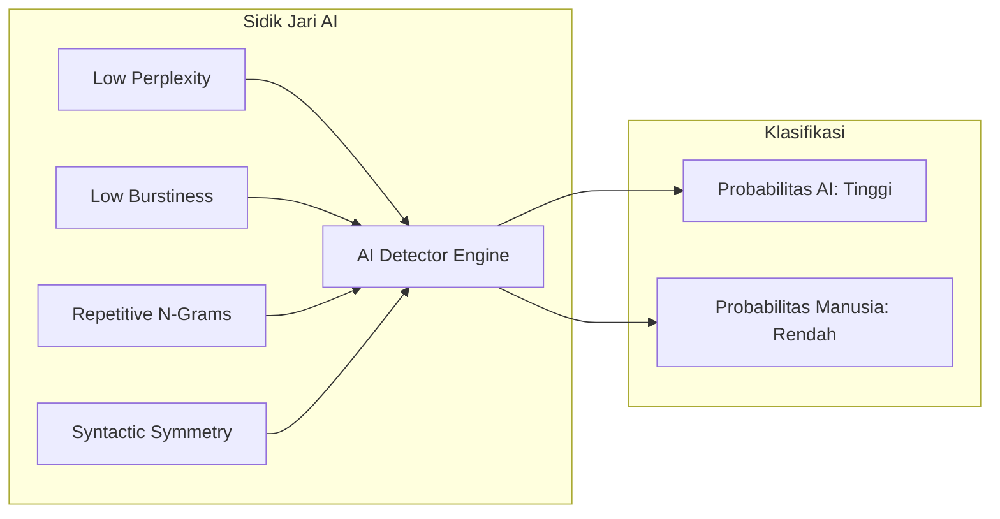
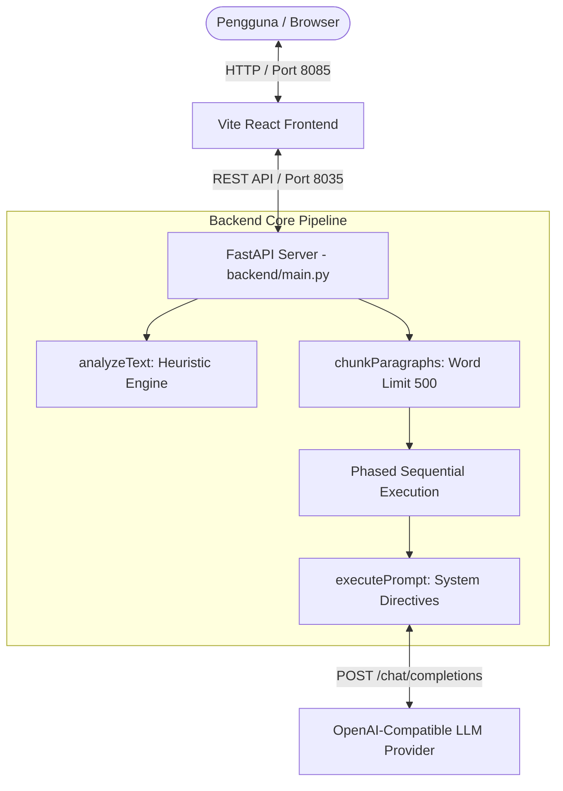
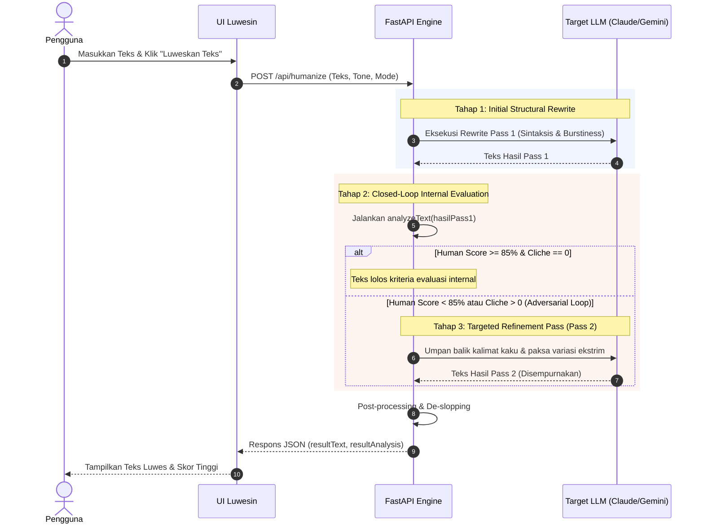

# Arsitektur Sistem — Luwesin Studio

Dokumen ini menjelaskan landasan teoritis, mekanisme deteksi AI, arsitektur teknis saat ini, serta peta jalan (*roadmap*) pengembangan **Luwesin Studio** — sistem penulisan ulang berbasis kecerdasan buatan untuk menghasilkan teks yang alami, berirama (*bursty*), luwes, dan terbebas dari pola mekanis mesin.

---

## 1. Ikhtisar & Filosofi Sistem

### 1.1 Masalah Pokok: Bahasa Mesin yang Kaku
Model bahasa besar (LLM seperti ChatGPT, Claude, dan Gemini) secara alamiah menghasilkan teks dengan karakteristik khas:
- Pilihan kata yang terlalu mudah ditebak (*low perplexity*).
- Ritme panjang kalimat yang seragam dan monoton (*low burstiness*).
- Penggunaan frasa klise transisi berulang (*AI slop*), seperti *"tentu saja"*, *"perlu diingat bahwa"*, *"dalam era modern ini"*, atau *"furthermore"*.
- Struktur sintaksis simetris yang jarang ditemui pada tulisan manusia sejati.

### 1.2 Filosofi "Luwesin"
Nama **Luwesin** berasal dari bahasa Indonesia/Jawa *"luwes"*, yang bermakna fleksibel, mengalir gemulai, dan tidak kaku.
- **Bukan Sekadar Paraphraser / Pemutar Kata**: Paraphraser tradisional (seperti versi awal QuillBot) hanya mengganti sinonim kata per kata tanpa mengubah kerangka kalimat. Pendekatan ini mudah dideteksi oleh AI detector modern.
- **Perombakan Struktural (*Structural Rewrite*)**: Luwesin merombak sintaksis, memecah kalimat monoton menjadi perpaduan kalimat menohok (*punchy*) dan kalimat majemuk bertingkat yang mengalir, dengan mempertahankan 100% fakta dan kedalaman konteks asli secara seimbang (rasio panjang ~1:1).

---

## 2. Landasan Teori: Bagaimana AI Detector Bekerja

Detektor AI modern (seperti **GPTZero, Turnitin, CopyLeaks, dan Originality.ai**) tidak memahami semantik bacaan seperti manusia, melainkan mengukur **sidik jari statistik (*statistical fingerprint*)**:



### 2.1 Perplexity (Tingkat Ketertelusuran Kata)
- **Definisi**: Ukuran seberapa "terkejut" model bahasa terhadap kemunculan kata berikutnya.
- **Karakter AI**: LLM dilatih untuk memilih token dengan probabilitas kumulatif tertinggi (*highest next-token probability*). Hal ini membuat teks AI memiliki *perplexity* rendah karena sangat mudah ditebak oleh model evaluator.
- **Karakter Manusia**: Tulisan manusia memiliki *perplexity* tinggi dan berfluktuasi karena manusia menggunakan diksi yang kaya, metafora, idiom, dan variasi kosakata yang tidak selalu berada pada puncak probabilitas statistik.

### 2.2 Burstiness (Variasi Panjang & Irama Kalimat)
- **Definisi**: Varians dan deviasi standar panjang kalimat di sepanjang dokumen.
- **Karakter AI**: Cenderung menghasilkan kalimat dengan panjang seragam (rata-rata 15–22 kata per kalimat) secara terus-menerus.
- **Karakter Manusia**: Sangat dinamis (*bursty*). Manusia sering menaruh kalimat sangat pendek (3–6 kata), disusul kalimat panjang dengan anak kalimat majemuk (30–45 kata), disusul kalimat sedang.

### 2.3 N-Gram & Frasa Klise (*AI Slop*)
AI sering mengandalkan frasa transisi tertentu untuk menjembatani ide:
- **Bahasa Indonesia**: *"tentu saja"*, *"perlu dicatat bahwa"*, *"dalam era modern ini"*, *"berperan penting"*, *"secara keseluruhan"*, *"tidak dapat dipungkiri bahwa"*.
- **Bahasa Inggris**: *"delve into"*, *"testament to"*, *"crucial role"*, *"tapestry of"*, *"navigating the landscape"*, *"furthermore"*.

### 2.4 Keseimbangan Sintaksis Berlebih (*Syntactic Symmetry*)
AI gemar mengelompokkan 3 poin sejajar dalam satu kalimat:
> *"Sistem ini bertujuan untuk meningkatkan efisiensi, memangkas biaya, dan mempercepat alur kerja."*

Tulisan manusia cenderung asimetris, menyisipkan jeda percakapan, atau menekankan salah satu poin secara tidak seimbang.

---

## 3. Arsitektur Teknis Saat Ini (As-Is Architecture)

Luwesin Studio dibangun dengan pemisahan tanggung jawab yang ketat (*Separation of Concerns*) antara layer antarmuka pengguna (Frontend) dan engine pemrosesan (Backend).



### 3.1 Komponen Frontend (React + TypeScript + Tailwind CSS)
- **Lokasi**: `/frontend`
- **Port**: `8085`
- **Fitur Utama**:
  - `Header.tsx`: Identitas brand `luwesin` dan navigasi pengaturan API key / provider URL.
  - `EditorCard.tsx`: Panel ganda presisi (*dual-pane*) dengan tinggi toolbar terkunci seragam (`h-14`) agar border horizontal sejajar sempurna.
  - `ScoreMeter.tsx`: Visualisasi metrik autentisitas teks (Human Score, Burstiness Score, Cliche Count, Word Count).
  - `useHumanizer.ts`: Custom hook untuk orkestrasinya state analisis, input teks, dan panggilan asynchronous.

### 3.2 Komponen Backend (FastAPI + Python 3.14 via `uv`)
- **Lokasi**: `/backend`
- **Port**: `8035`
- **Modul Inti**:
  - `main.py`: Entrypoint REST API (`/api/config`, `/api/analyze`, `/api/humanize`). Menyediakan alias `app = applicationServer`.
  - `config.py`: Pengambilan variabel lingkungan terpusat dari `.env`.
  - `engine.py`:
    - `analyzeText()`: Mesin kalkulasi deviasi standar panjang kalimat (Burstiness) dan pencocokan pola regex klise dwibahasa (Inggris & Indonesia).
    - `chunkParagraphs()`: Pemecah dokumen cerdas berbasis paragraf ganda (`\n\n`) dengan batas ambang akumulasi 500 kata per *chunk*.
    - `executePrompt()`: Eksekutor panggilan API ke LLM dengan parameter `stream: False`, `max_tokens: 8192`, serta *fallback stream parser* untuk toleransi format Server-Sent Events (SSE).
    - `requestHumanization()`: Orkestrator sekuensial yang menggabungkan seluruh *chunk* hasil rewrite menjadi satu kesatuan dokumen utuh.

---

## 4. Arsitektur Generasi Berikutnya: Pipeline Adversarial (To-Be Roadmap)

Berdasarkan riset paper akademis *Adversarial Paraphrasing (NeurIPS)* dan repositori *StealthHumanizer*, peningkatan terbesar untuk mencapai efektivitas bypass detektor 100% adalah beralih dari model *single-shot* ke **Adversarial Closed-Loop Refinement**:



### 4.1 Elemen Utama Pipeline Adversarial
1. **Internal Evaluator-in-the-Loop**:
   - Setelah teks di-rewrite, engine langsung memeriksa skor burstiness dan keberadaan sisa klise secara lokal sebelum diserahkan ke pengguna.
2. **Targeted Refinement (Pass 2)**:
   - Jika kalimat tertentu masih terdeteksi kaku, sistem hanya memoles kalimat yang bermasalah dengan instruksi korektif yang tajam.
3. **Dual Processing Modes**:
   - **Mode Cepat (Fast Mode)**: 1-Pass langsung untuk kebutuhan instan.
   - **Mode Luwes Mendalam (Deep / Ninja Mode)**: Multi-Pass adversarial refinement untuk teks akademis, esai resmi, atau artikel yang wajib lolos Turnitin/GPTZero.
4. **Dynamic Temperature & Top-P Jittering**:
   - Menyesuaikan nilai *temperature* secara acak antara 0.80 – 0.92 per *chunk* untuk memecah pola probabilitas token yang monoton.

---

## 5. Spesifikasi Antarmuka API

### 5.1 `POST /api/analyze`
Melakukan analisis heuristik instan terhadap teks sumber tanpa memanggil LLM.
- **Request Body**:
  ```json
  {
    "sourceText": "string (min_length: 1)"
  }
  ```
- **Response**:
  ```json
  {
    "analysisData": {
      "wordCount": 142,
      "sentenceCount": 8,
      "burstinessScore": 42,
      "clicheCount": 0,
      "humanScore": 85,
      "verdictText": "Natural Human"
    }
  }
  ```

### 5.2 `POST /api/humanize`
Menjalankan penulisan ulang teks melalui pipeline Luwesin.
- **Request Body**:
  ```json
  {
    "sourceText": "string (min_length: 1)",
    "toneValue": "natural | academic | business | casual",
    "providerUrl": "optional string",
    "apiKey": "optional string"
  }
  ```
- **Response**:
  ```json
  {
    "resultText": "string",
    "resultAnalysis": {
      "wordCount": 145,
      "sentenceCount": 8,
      "burstinessScore": 45,
      "clicheCount": 0,
      "humanScore": 90,
      "verdictText": "Natural Human"
    }
  }
  ```

---

## 6. Standar Pengembangan & Panduan Pemeliharaan
- **Linearitas & Kesederhanaan**: Mengikuti prinsip *Lazy Developer* yang terdokumentasi pada `AGENTS.md`. Hindari abstraksi berlebihan (factory/wrapper) yang tidak esensial.
- **Penamaan Variabel**: Format `camelCase` deskriptif maksimal dua kata (contoh: `sourceText`, `wordCount`, `textChunks`).
- **Format Logging Sistem**: Wajib mengikuti pola `(YYYY-MM-DD HH:MM:SS) functionality message`.
- **Manajemen Dependensi**: Dikelola secara modular di dalam `backend/` menggunakan `uv` (`pyproject.toml` dan `uv.lock`). Root proyek tetap bersih sebagai pengarah repositori.
